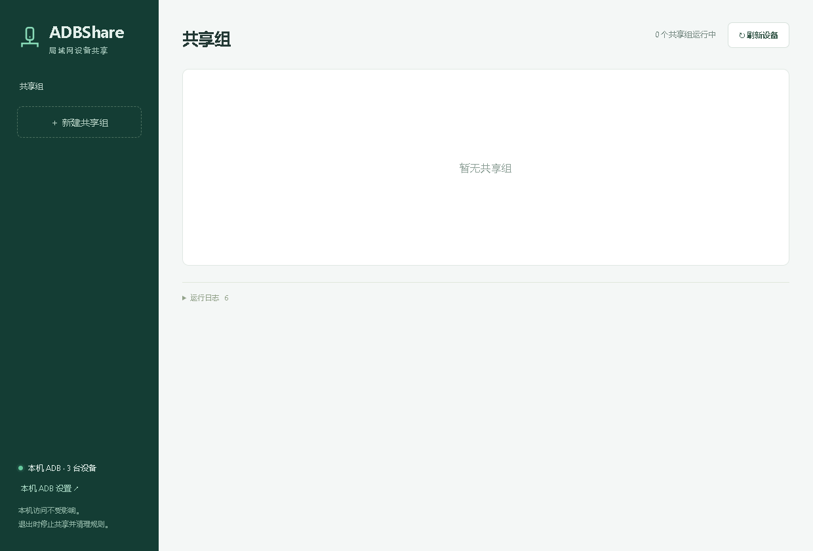

# ADBShare



将本机连接的 Android 设备按组共享给局域网中的电脑，远端使用标准 `adb -H / -P` 命令访问。本机继续使用原有 ADB Server，无需将设备切换为网络调试模式。

## 功能

- 多组共享与设备隔离，限制允许接入的来源 IP / 网段。
- 共享组和单设备独立启停；Windows 防火墙规则管理与共享状态联动。
- 全局、组、设备三级运行日志，支持交互预览、复制、导出和重置。
- 中英文界面、明暗主题，Windows x64 独立 EXE 与 Linux x64 AppImage。

## 下载与使用

从 [Releases](https://github.com/woooooooooolf/ADBShare/releases) 下载程序及同名 `.sha256` 校验文件。已发布的 V0.8.0 为 Windows 版本，Linux AppImage 将随后续版本提供。本项目不内置 adb，运行无需联网。

| 平台        | 运行条件                                                                                      |
| ----------- | --------------------------------------------------------------------------------------------- |
| Windows x64 | WebView2 Runtime、Android Platform Tools                                                      |
| Linux x64   | 目标 Ubuntu/Kubuntu 22.04 起的 LTS、Debian 12 起的桌面环境；本地 ADB 与正确的 USB / udev 权限 |

Linux 下载后赋予 AppImage 执行权限，并以普通用户启动；root / sudo 启动会打印提示并退出。详细边界及验证情况见 [平台支持](docs/platforms.md)。

Linux 缺少中文界面所需字体时会自动使用并保存英文，切换中文前重新检查。程序不内置字库，用户输入的中文仍需要系统字体支持。

1. 用本机 ADB 连接设备，并在设备上允许 USB 调试。必要时在“本机 ADB 设置”中启动 Server。
2. 新建共享组，选择设备、局域网网卡、空闲端口和允许的来源地址。
3. 点击“保存并共享”。Windows 按提示批准防火墙规则配置；Linux 请事先在系统防火墙中放行共享 TCP 端口。
4. 在获准的远端电脑执行界面中的命令：

```powershell
adb -H 192.168.1.10 -P 15037 devices -l
adb -H 192.168.1.10 -P 15037 -s SERIAL shell
```

Windows 停止组保留规则，移除规则会先停止组，删除组和退出程序会清理规则。Linux 不管理系统防火墙，来源地址限制仍由程序执行。

配置存放在用户专属目录，位置可在运行日志窗口查看；移动程序不影响配置。普通启动为单实例，重开程序不会自动恢复共享。日志仅保存在本次运行的内存中，交互数据为有上限的预览。

仅在可信局域网使用。当前不提供账户认证或加密，不支持跨主机 `forward/reverse`，不承诺 IDE 或投屏兼容性。真机、双机 LAN 与实际 UAC 防火墙操作的验证边界见 [验证记录](docs/validation.md)。

## 开发

基于 Tauri 2、Rust 和 TypeScript。需要 Node.js 24、工程指定的 Rust 工具链、Visual Studio C++ Build Tools 和 WebView2。

```powershell
npm ci
cargo fetch --locked --manifest-path src-tauri/Cargo.toml
npm run tauri -- dev

# 检查、构建与打包
npm run version:check
npm test
npm run build:app
npm run package
```

后续每平台仅提供程序文件和追加 `.sha256` 的同名校验文件，源码可使用 GitHub 在 Release 页自动提供的归档。交付文件位于 `artifacts/<版本>/`。运行 `scripts/demo.ps1` 可启动隔离的虚拟设备演示；更多检查见 [验证记录](docs/validation.md)。

## 工程结构与维护

- `src/`：应用入口、共享类型与独立界面模块。
- `src-tauri/src/`：配置、ADB 网关、内存历史、防火墙和平台实现。
- `scripts/tests/`：隔离回归；`scripts/tools/`：手工维护工具。

`npm run format` 统一源码格式，`npm run clean -- -WhatIf` 预览生成物清理。目录和数据保留约定见 [工程结构](docs/architecture.md)，检查命令及边界见 [验证说明](docs/validation.md)。

## 版本与发布

**V0.8.0** 为功能初步就绪基线，后续开发基于此版本迭代。GitHub Actions 检查主分支，在版本标签上构建并发布 Windows x64 EXE、Linux x64 AppImage 及各自的校验文件。成果物命名与 `Changed` / `Fixed` / `Docs` 简体中文说明规范固定保存在 [发布流程](docs/releasing.md)，修改点见 [更新记录](CHANGELOG.md)。

## 许可证

[GPLv3（GPL-3.0-only）](LICENSE)。第三方组件保留各自许可证，详见 [第三方声明](THIRD_PARTY_NOTICES.txt)。
