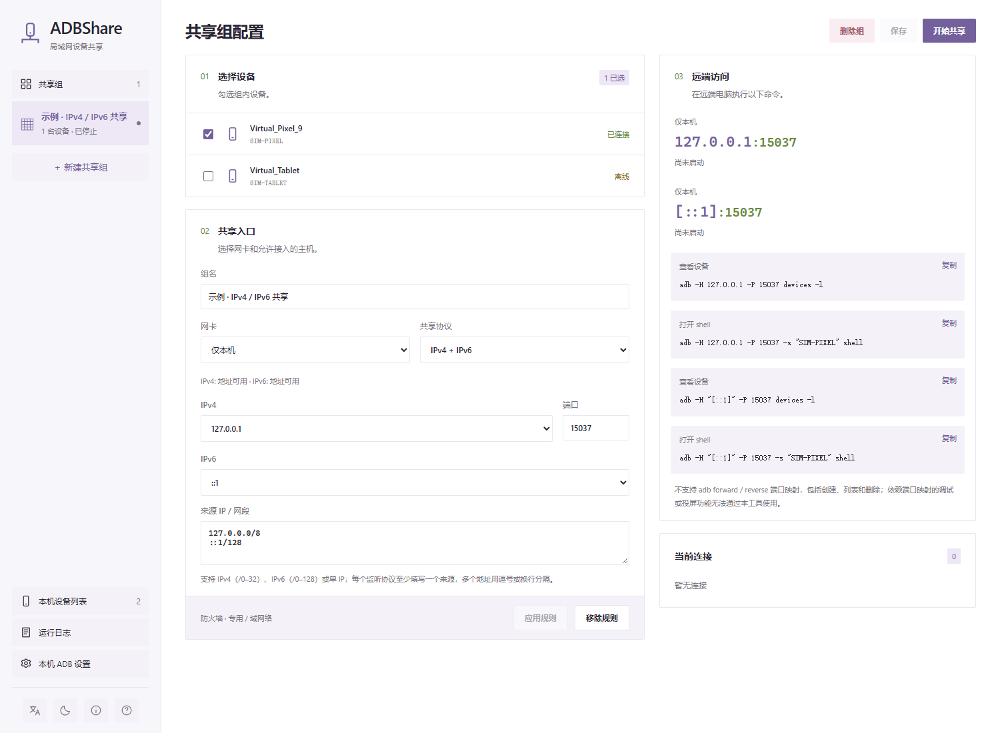

# ADBShare

将本机连接的 Android 设备按组共享给远端电脑，远端使用标准 `adb -H / -P` 访问。本机继续使用原有 ADB Server，无需将设备切换为网络调试模式。



主界面示例使用虚拟设备与回环地址，展示 IPv4 + IPv6 配置。

## 功能

- 多组共享与设备隔离，支持共享组和单设备独立启停。
- 每组可选仅 IPv4、仅 IPv6 或双协议，检查网卡状态、可用地址及绑定能力。
- 支持来源 IP / CIDR 白名单与自行配置的跨网段中转，Windows 防火墙规则随共享状态管理。
- 提供运行日志、标准设备选择与跟踪、F1 帮助，中英文界面和明暗主题。

## 下载与使用

从 [Releases](https://github.com/woooooooooolf/ADBShare/releases) 下载 **V0.11.0** 程序及同名 `.sha256` 文件。本项目不内置 adb，运行无需联网。

| 平台        | 运行条件                                                                                            |
| ----------- | --------------------------------------------------------------------------------------------------- |
| Windows x64 | WebView2 Runtime、Android Platform Tools                                                            |
| Linux x64   | 目标 Ubuntu/Kubuntu 22.04 起的 LTS、Debian 12 起的桌面环境；Android Platform Tools、USB / udev 权限 |

Linux 下载后赋予 AppImage 执行权限，以普通用户启动，并自行放行共享 TCP 端口。详细兼容边界与字体要求见 [平台支持](docs/platforms.md)。

1. 在共享主机连接 Android 设备并允许 USB 调试，确认本机 ADB Server 可用。
2. 新建共享组，选择设备、网卡、协议、可用地址、端口和允许的来源 IP / 网段。
3. 点击“保存并共享”；Windows 按提示配置防火墙规则。
4. 在获准的远端电脑执行界面提供的命令，例如：

```powershell
adb -H 192.168.1.10 -P 15037 devices -l
adb -H 192.168.1.10 -P 15037 -s SERIAL shell
adb -H "[fd12:3456:789a::10]" -P 15037 devices -l
```

配置保存在用户专属目录，移动程序不影响配置，重开程序不会自动恢复共享。停止组会断开连接；Windows 停止时保留规则，删组或退出时清理规则。日志仅保留在本次运行的内存中。

## 使用边界

- 来源支持 IPv4 / CIDR（前缀 0–32）及 IPv6 / CIDR（前缀 0–128），按实际 TCP 对端地址匹配；每种监听协议至少配置一个同协议来源。
- 当前没有账户认证或加密，请仅允许可信主机。公网中转的访问控制和链路加密需自行配置；Windows 自动防火墙规则适用于专用 / 域网络。
- **不支持 `adb forward` / `adb reverse` 端口映射**，依赖端口映射的调试或投屏功能无法通过本工具使用。
- “仅 IPv6”指共享入口，本机上游 ADB 仍使用 IPv4 回环地址。链路本地 IPv6 的接口编号、网卡检查及中转配置见 [IPv6 与协议模式](docs/ipv6.md)。

完整命令支持范围及差异见 [ADB 命令支持范围](docs/adb-support.md)。实际验证情况见 [验证记录](docs/validation.md)。

## 开发与维护

基于 Tauri 2、Rust 和 TypeScript。需要 Node.js 24 与 [工程指定的 Rust 工具链](rust-toolchain.toml)；Windows 另需 Visual Studio C++ Build Tools 和 WebView2，Linux 构建依赖见 [平台说明](docs/platforms.md)。

```powershell
npm ci
cargo fetch --locked --manifest-path src-tauri/Cargo.toml
npm run tauri -- dev

# 检查、构建与打包
npm run version:check
npm test
npm run build:app
npm run package
```

打包文件位于 `artifacts/<版本>/`，每个平台仅提供程序及同名 `.sha256` 文件，源码使用 GitHub 自动归档。`scripts/demo.ps1` 可启动隔离的虚拟设备演示。

源码结构与维护命令见 [工程结构](docs/architecture.md)，贡献和发布流程见 [仓库维护](docs/repository.md)、[发布说明](docs/releasing.md)，版本变化见 [更新记录](CHANGELOG.md)。问题反馈使用 [Issues](https://github.com/woooooooooolf/ADBShare/issues)，安全问题使用 [私密报告](SECURITY.md)。

## 许可证

[GPLv3（GPL-3.0-only）](LICENSE)。第三方组件保留各自许可证，详见 [第三方声明](THIRD_PARTY_NOTICES.txt)。
