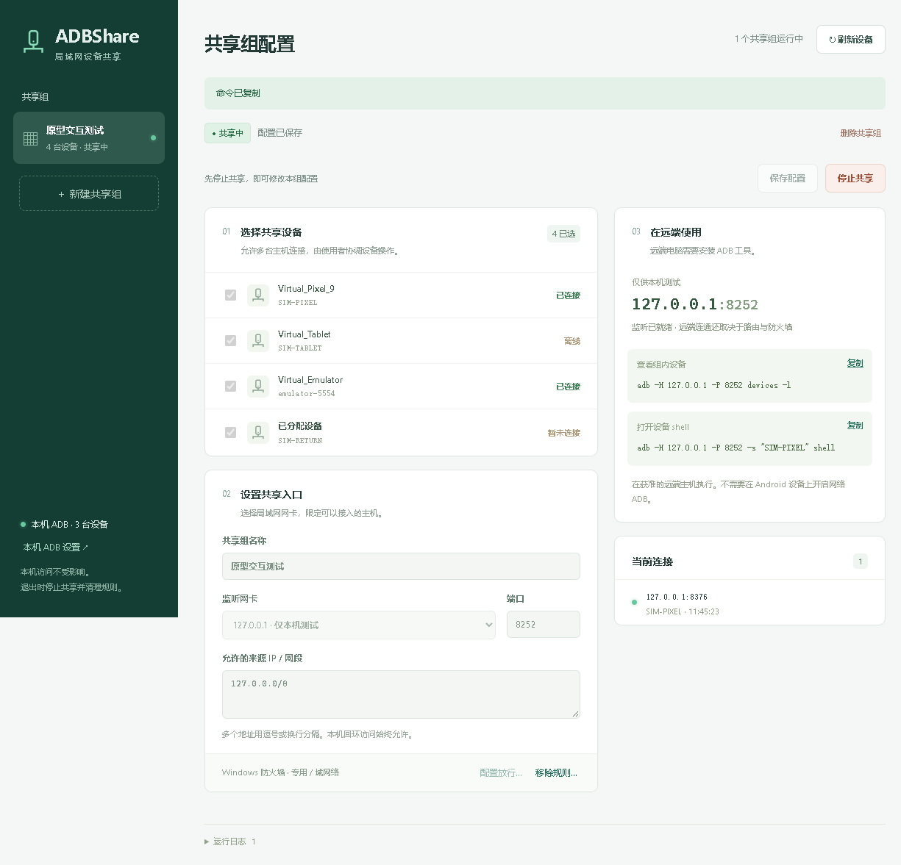

# ADBShare

基于 Tauri 2 / Rust / TypeScript 的 Windows 局域网 ADB 共享原型。将本机已有 ADB Server 的设备分组，让远端使用标准 `adb -H 主机 -P 端口` 访问获准设备。本机仍可使用原来的 `adb shell`，不需要将 Android 设备改为网络调试模式。

## 试用

运行 `artifacts/ADBShare-0.1.0-windows-x64.exe`。它是应用 EXE，无需安装本工具；Windows 需要 WebView2 Runtime。本工具不内置 Platform Tools，实际设备连接由本机已有的 ADB Server 管理。

1. 用本机 ADB 连接设备，在设备上允许 USB 调试。
2. 打开 ADBShare。若显示“本机 ADB 未连接”，进入左下角“本机 ADB 设置”，填写 adb 路径，点击“启动本机 ADB”。也可在外部运行 `adb start-server`。
3. 点击侧栏的“新建共享组”，勾选设备，选择实际局域网网卡和一个空闲端口。
4. 检查“允许的来源 IP / 网段”。默认取所选网卡子网，可改为一台或多台主机的 IPv4；支持逗号、空格、换行分隔。
5. 保存配置。需要时点击“配置放行…”，仅防火墙辅助进程会触发 UAC；仅配置专用/域网络的本程序、指定地址、端口及来源。
6. 点击“开始共享”，在获准远端主机运行右侧命令。例如：

```powershell
adb -H 192.168.1.10 -P 15037 devices -l
adb -H 192.168.1.10 -P 15037 -s SERIAL shell
adb -H 192.168.1.10 -P 15037 -s SERIAL logcat
adb -H 192.168.1.10 -P 15037 -s SERIAL push test.txt /data/local/tmp/
```

“监听已就绪”只表示本地监听成功，双机可达还取决于路由、网络类型和防火墙。选 `127.0.0.1` 时仅供同机测试，无法从其它电脑访问。

运行中请先停止组再编辑；删除组时会自动停止该组共享、清理规则，再删除配置。清理失败或取消 UAC 时会保留组供重试。关闭主窗口会停止所有共享并清理创建的规则；清理未完成时保留窗口，可以重试退出。重新打开保留配置，但不会自动开始共享。设备暂时断开不会丢失组成员关系。同一设备可以属于多个组，不实现互斥或多人操作仲裁。

配置保存于 EXE 同级的 `data/config.json`；请放在可写目录。`ADB_SHARE_DATA_DIR` 可以覆盖配置目录。损坏配置会显示错误并阻止覆盖，需要修复或移走后重启。

防火墙规则以组 UUID 标识。普通“停止共享”关闭连接，删除组和退出程序自动清理规则。仅存在待清理规则时请求 UAC，退出时合并清理多组规则。`data/firewall-rules.json` 记录尚需清理的规则，以便失败或重启后重试，也会识别此前版本为当前 EXE 创建的遗留规则。移动 EXE 后需要重新配置规则。

## 无真机演示

本仓库提供完全隔离的虚拟上游，展示在线、离线和暂未连接设备，模拟简单 shell 与文件传输。需要 Node.js：

```powershell
.\scripts\demo.ps1
```

演示使用 `work/demo` 配置和回环监听，不连接真实 ADB Server，不创建防火墙规则。关闭演示窗口会结束虚拟上游。它不能证明真实硬件或双机局域网兼容性。

## 开发与验证

Windows 开发需要 Rust MSVC、Visual Studio C++ Build Tools、Node.js 和 WebView2。

```powershell
npm ci
npm run tauri -- dev
npm run build
npm test
npm run build:app
```

编译产物为 `src-tauri/target/release/adbshare.exe`。执行 `scripts/package.ps1` 可复制为命名产物并生成 SHA256SUMS。

标准 adb 集成测试会启动原型的 headless 模式和虚拟上游，只在回环地址运行，不触碰真实设备或防火墙：

```powershell
cargo build --locked --manifest-path src-tauri/Cargo.toml
npm run test:integration
# 实际 Tauri 窗口交互回归（使用独立虚拟上游和配置）：
npm run test:ui
# 对最终 Release EXE 验证：
$env:ADB_SHARE_EXE = "$PWD\artifacts\ADBShare-0.1.0-windows-x64.exe"
npm run test:integration
```

## 当前兼容范围

- 已实现：按序列号过滤 devices / devices-l；文本 track-devices；serial、transport-id、USB/local/any 选择；选定设备后的双向字节流。
- shell、logcat、sync、安装等设备服务使用字节透传；实际设备/命令的兼容程度以验证记录为准。
- 不实现 forward/reverse 的跨主机数据端口；相关命令直接拒绝，防止影响其它组的主机资源。
- 不承诺 Android Studio、投屏、protobuf tracking 或所有 ADB 子命令。
- 只管理局域网访问范围，来源限制为私有 IPv4/CIDR（另支持回环）。回环访问始终允许；没有账户、口令或加密。
- 启动前验证上游和监听端口；不接管 USB、不终止/替换本机 ADB Server。
- 同时打开多个应用实例尚不属于推荐用法；本工具未实现跨实例配置协调。

工程基线见 [docs/design-baseline.md](docs/design-baseline.md)，测试与待验证项见 [docs/validation.md](docs/validation.md)。


